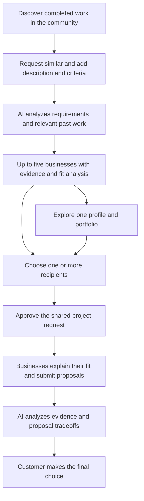
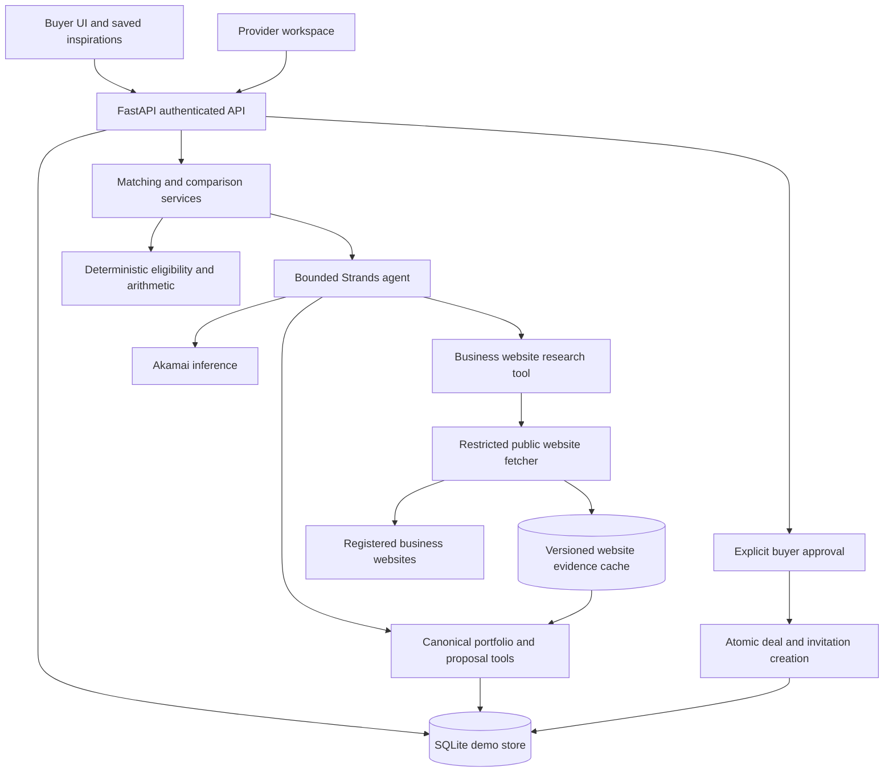

# DealFeed Product Execution and Implementation Blueprint

Prepared October 11, 2026. Updated to reflect the five-business discovery and analysis proposition. Status: proposed implementation plan. Existing capabilities and planned additions are distinguished below; this blueprint does not represent completed matching or multi-provider bidding functionality.

DealFeed is a community marketplace where an individual or company discovers completed work they like and requests something similar. The customer adds a description, budget, specifications, keywords, and must-haves. AI analyzes businesses, their relevant completed projects, and additional evidence from their public websites, then shortlists the five that most closely align with the customer's desired result. The customer can explore one business in depth or send the project request to selected businesses. Businesses respond with their proposed approach and evidence of why they are a good fit; AI analyzes the fit and tradeoffs, and the customer makes the final decision.

The product promise is: **Find work you like. Find the businesses that can deliver it. Choose with evidence.** Five is the shortlist target, not a promise of five responses. Return fewer suitable businesses when the available evidence cannot support five, and explain the shortfall.

## Product outcome and launch scope

The buyer should understand how closely each business matches the desired standard before contacting anyone, then compare provider responses with the help of AI. Businesses should be able to demonstrate relevant achievements and explain their approach, scope, timeline, and price. The customer controls which route to explore, which businesses receive a request, and the final choice.

| Decision | Product requirement |
|---|---|
| Customer | An individual or company looking for a service or project inspired by community work |
| Business | A provider with relevant completed projects and evidence of its capabilities and past achievements |
| Community | Publicly shared completed work and business profiles; discovery is the entry point |
| Starting material | One selected completed project and an additional description; saved examples are optional supporting references |
| Matching criteria | Budget, project specifications, keywords, must-haves, desired standard, and relevant past achievements |
| Shortlist | Five distinct suitable businesses when supported by the catalog; fewer with an explanation otherwise |
| Customer routes | Explore one business without sending anything, or approve requests to any selected subset of the five |
| Main transaction | One approved project request represented by a parent Deal and one to five provider invitations |
| Provider response | A fit pitch, relevant completed work and outcomes, proposed approach, scope coverage, timeline, and provider-authored quote |
| AI responsibility | Research public business websites, analyze requirements and sourced portfolio evidence, shortlist businesses, explain fit, and analyze provider responses |
| Customer responsibility | Confirm requirements, select recipients, review analysis, and make the final provider choice |
| Initial success measure | Customer reaches a justified provider decision using the same project request throughout |
| Deferred | Payments, contractual acceptance, live negotiation, chat, production onboarding, and new upload infrastructure |

For the hackathon, demonstrate this general journey with a restaurant website example. That is a demo scenario rather than a product restriction; individuals, companies, and the existing service categories remain part of the product. Service location and delivery mode are constraints only when relevant to the request. Establish enough completed-project evidence in the chosen demo category to support five candidates before expanding the seed coverage.

Saved projects express inspiration rather than permission to reproduce someone else's work. Ask which attributes the customer likes and let them correct inferred preferences. Do not require multiple likes before allowing a request for something similar.

### Product journey

## Prize strategy and demo constraints

Target AWS Strands as the primary track and Akamai as the complementary track through the same working product. Each advertises a $2,500 prize. AWS emphasizes Strands integration and creative agents; Akamai evaluates usefulness, platform or inference usage, execution, and originality. The event permits participating in more than one challenge. Confirm submission mechanics and whether awards can be combined with organizers. [Hack Midwest prizes](https://hackmidwest.com/#prizes).

The published submission cutoff is October 11 at 8:00 a.m. Kansas City time. The prototype pitch lasts three minutes and allows no slides; code changes stop at the competition cutoff. Follow any updated onsite instructions. [Hack Midwest schedule and rules](https://hackmidwest.com/#schedule).

Sponsor integration must be demonstrated with an actual successful inference call and tool execution. A configuration flag, sponsor logo, or rehearsal response does not establish live integration. The [Akamai starter kit](https://github.com/akamai-developers/akamai-workshop-hackmidwest) provides workshop inference and cloud guides and requires an organizer-issued team key. Confirm the accepted hosting arrangement with the sponsor; prefer the existing reliable runtime while proving inference, then deploy only if time and eligibility require it.

## Current foundation and required changes

| Area | Verified repository foundation | Required addition |
|---|---|---|
| Discovery | Searchable project feed, category filters, profiles, mobile layout | Request similar work directly from a community project; optionally save more inspiration |
| Briefs | Buyer input, editable brief, explicit submission approval | Provider-neutral brief informed by multiple references |
| AI | Strands retrieves one project and business; Akamai generates its brief | Candidate retrieval, website research, constrained ranking, proposal comparison |
| Website evidence | Sample business URLs exist; no website research pipeline | Restricted public-page retrieval, source excerpts, research timestamps, and evidence-versioned analysis |
| Requests | A request has one business and one reference project | Parent deal linking up to five existing requests |
| Quotes | Provider supplies price, scope, timeline; one proposal per request | Fit pitch, approach, relevant achievements, deliverable coverage, exclusions, assumptions, quote basis |
| Persistence | SQLite locally; DynamoDB adapter for AWS; separate browser rehearsal | Atomic deal and invitation creation, conditional updates, idempotency |
| Deployment | Static Next.js export; local API; AWS infrastructure template | Verify the selected runtime and live inference path |

Live inference and cloud deployment remain unverified in the repository's verification record. This plan does not change that status. See [verification](VERIFICATION.md), [API](API.md), and [deployment](DEPLOYMENT.md).

There are ten sample businesses. Active website projects currently belong to Juniper Digital and Morrow Studio; other listed website capabilities do not by themselves supply active portfolio evidence. Seed seven or eight candidate businesses for the demo, with relevant, clearly labeled completed sample work for at least five eligible businesses and deliberate near-misses. This makes ranking and exclusion visible instead of returning the entire catalog. New matches require an explicitly completed, publicly shareable, non-archived portfolio project. The existing Project type does not encode completion or verification; add those fields instead of assuming every active record proves completed work. Preserve historical references.

## Buyer and provider experience

| Screen | Main interaction | Required behavior |
|---|---|---|
| Feed | Discover completed work; request something similar | A single project is enough to start; optionally save more references and edit the saved set |
| Match composer | Add description, budget, specifications, keywords, must-haves, desired standard, date and priorities | Prefill the selected example; distinguish explicit requirements from inferred preferences; preserve input on failure |
| Preference review | Confirm inferred style and functional requirements | Explicit edits override inferences; regenerate matches when confirmed requirements change |
| Shortlist | Inspect up to five businesses and AI fit analysis | Explain criteria, relevant completed projects, achievements, website findings with source links and checked dates, limitations, and unknowns |
| Business exploration | Inspect one business and its relevant portfolio | Keep the request context and allow return to the shortlist; exploration creates no invitations or obligations |
| Request approval | Choose one, several, or all five and review the shared request | Show exact recipients; unresolved essential questions block submission; no automatic contact |
| Deal detail | Track selected businesses and responses | Display invited/responded counts; the customer can proceed with available responses |
| Provider workspace | Explain why the business fits and submit a proposal | Include approach, comparable completed projects, outcomes and scope/price/timeline; hide competitors' responses |
| Business and offer analysis | Compare desired standard, achievements, approach, coverage, budget and conditions | Separate portfolio evidence from provider claims and AI conclusions; show raw responses beside the analysis |
| Customer decision | Choose a submitted proposal after reviewing the evidence | Core flow; record the customer's preferred provider explicitly, without payment or contractual acceptance |

On an iPhone 16 viewport of 393 by 852 CSS pixels, shortlist cards stack vertically. Proposal comparison uses a provider selector with a shared deliverable list instead of requiring a wide table. Desktop uses a comparison matrix or selectable cards that can accommodate five businesses without compressing their evidence into unreadable columns. Primary actions remain reachable, controls have generous touch targets, and errors preserve form state. Keep charcoal, white, light gray, and lime accents.

## System architecture

Retain the installed Strands SDK and OpenAI-compatible adapter. Its configurable endpoint supports the intended Akamai connection, subject to the real endpoint's capabilities. Verify against the installed package rather than migrating SDK generations during the hackathon. [Strands model provider documentation](https://strandsagents.com/docs/user-guide/sdk/model-providers/openai/).

The current direct mode uses Akamai for Strands orchestration and generation. The existing Bedrock fallback changes the orchestrator but still calls Akamai for generation. An AWS-only fallback needs a deliberate generation-provider change; it is not an existing configuration switch.

Use the connected FastAPI path for the new matching and project-request flow. Preserve the existing browser rehearsal for legacy requests. When no API is configured, explain that five-business matching requires the connected demo; do not duplicate the entire new backend in localStorage under deadline pressure. Saved inspiration IDs may remain local, but match runs, approvals, invitations, and quotes must use the API.

The current `npm run dev:local` launcher intentionally forces rehearsal and strips Akamai settings. Live validation requires a separate documented launch configuration for the API and frontend; changing environment variables around that rehearsal launcher is insufficient.

## Matching design

### Canonical input

Capture service category separately from client industry. Use `Website development` for the service and `restaurant` for the industry. Normalize legacy category labels at the retrieval boundary rather than treating `Restaurant` as a provider service.

The input contains the inspiration project IDs, additional description, structured project specifications and deliverables, customer keywords, explicit must-haves, confirmed desired-standard facets (such as style, finish, complexity, or scale), required capabilities, budget in integer cents with currency, target date, delivery mode, and customer priorities. Preserve the source of each criterion: customer-entered, AI-inferred, or customer-confirmed. The specification and must-haves define what success means for this request. A budget may be unknown. A date is a target until a provider commits. Contact details are unnecessary for ranking and should be omitted from model inputs.

Store the buyer's confirmed preferences as a snapshot on the match run. Local saved projects are a convenience; the server resolves and validates every selected ID. Do not trust client-supplied descriptions, provider IDs, or claimed portfolio relationships.

### Candidate selection

1. Retrieve completed, publicly shareable selected projects and their style, industry, capability, specification, keyword, and achievement metadata.
2. Interpret written requirements and propose a preference summary for buyer confirmation.
3. Apply known required-service and must-have checks against catalog evidence, including relevant service-area constraints. Confirmed conflicts are disqualifying; absent evidence remains unresolved and may be supplemented through website research before final eligibility checks.
4. Retrieve comparable completed projects and sourced achievements for potentially eligible catalog businesses. Enrich them with cached or newly researched website evidence before final eligibility and ranking; do not discard candidates solely because useful information is absent from a catalog field. Use keywords and their semantic meaning to find related work, then compare actual specifications and results. For the small seed catalog, scan canonical records and send a bounded candidate set to the model; a vector database is unnecessary.
5. Recheck eligibility against the collected evidence, flag contradictions, and rank businesses using the confirmed request, budget evidence, specification coverage, keywords, desired standard, and relevant past achievements. Similar keywords alone cannot outweigh a missing must-have or contradictory evidence. Return up to five distinct businesses with evidence references and unresolved questions.
6. Validate all returned IDs, business/project relationships, required fields, and eligibility before displaying results.

Unknown availability or historical pricing is not evidence of meeting a deadline or budget. If the buyer requires confirmation of a non-negotiable and evidence is missing, display the candidate separately as requiring confirmation rather than calling it qualified. Known conflicts exclude a candidate. Do not relax constraints silently to fill five slots.

Use project metadata for the first version. The presence of an image URL does not mean the model inspected the image. Curated tags such as `warm`, `editorial`, and `minimal` must be labeled sample metadata where applicable. Actual multimodal image analysis is a later addition after model support is tested.

### Analysis criteria and achievement evidence

| Criterion | Evidence and display rule |
|---|---|
| Budget | Compare the request with disclosed starting prices or comparable project ranges only when currency, scope basis, and source are known. Label historical indications separately from the current proposal. A confirmed minimum above a strict cap fails that constraint; absent pricing remains unknown. |
| Specifications | Map requested deliverables, scale, complexity, and technical requirements to comparable completed work and listed capabilities. Show supported matches, gaps, and unresolved items. |
| Keywords | Use customer keywords to retrieve relevant work, including synonyms. Explain substantive matches; repeated words or keyword stuffing do not establish capability. |
| Must-haves | Show met, conflicts, or needs confirmation for each essential requirement. A known conflict excludes a business from the qualified shortlist. |
| Desired standard | Compare customer-confirmed style, finish, quality expectations, and functional standard with relevant evidence. Present subjective similarity as analysis rather than an objective quality guarantee. |
| Past achievements | Cite comparable completed work, its scope, completion date, the business's role, outcomes, and the source of each outcome. Explain why the achievement is relevant to this request. |

Add portfolio fields for completion state/date, service category, industry, specification and style tags, project role, and sourced outcomes. Each outcome stores its claim, source reference, time period or context when supplied, and evidence status: `sample`, `provider_reported`, or `independently_supported`. Independently supported requires an actual attributable source and review; a provider checking a box does not establish it. Preserve public sharing permission and source visibility.

Do not invent results, client satisfaction, budgets, awards, or delivery performance. More projects or a larger reported metric does not automatically imply better fit. Distinguish missing evidence from poor performance and show the reason for uncertainty.

Each shortlisted business receives analysis before any invitation: strongest alignments, comparable completed work, relevant achievements, source-linked website findings, budget indications, must-have coverage, and open questions. After proposals arrive, update the analysis with the business's specific approach and commitments. Preserve the original match analysis and version the new assessment so the customer can see what changed. Never imply that a persuasive pitch independently verifies its claims.

### Business website research

The AI can read a registered business's public website to learn about its services, specialisms, process, completed work, client case studies, and reported outcomes. Research supplements the community portfolio before shortlisting and supports deeper analysis when the customer explores a business or compares its proposal. An example finding is: “This business describes two comparable booking projects in its case studies; its service page lists ongoing maintenance. Your proposal still needs to confirm whether maintenance is included.” Each part links to its actual source.

Start from the business's registered, normalized website URL and record how its association with the business was established. Use a manually reviewed domain allowlist for the hackathon. Do not guess a domain from the business name or attribute a similarly named company's work to the candidate. Website research enriches catalog businesses; it does not silently add unregistered businesses to the invitation list. Website case studies use their own evidence IDs and cannot masquerade as canonical Project IDs.

Prioritize relevant service and case-study pages linked from the site. Initial configurable limits are four content pages per business, eight candidate businesses per matching run, two link levels, three concurrent fetches globally, one per host, five seconds per fetch, and a 45-second research-job deadline. Bound decompressed content size to 1 MB per page and extracted text to 20,000 characters. These are proposed limits to tune, not measured performance. Fetch public HTML without executing scripts for the MVP; defer browser rendering and document downloads when ordinary text cannot be extracted.

Run research asynchronously and cache evidence independently of customer requests. Use a proposed 24-hour freshness window, record the actual retrieval timestamp, and distinguish source publication dates from fetch dates. The ordinary matching latency target assumes usable cached evidence. A cold request displays research progress; if coverage is partial, show what was checked and continue with explicit unknowns. Customers can request a bounded refresh. An inaccessible or missing website is not evidence of inferior capability and does not disqualify a business that has sufficient community evidence.

Represent every material finding with an evidence ID, business ID, source/final URL, page title, page type, short excerpt, retrieval time, publication/update date when stated, content hash, extraction version, and provenance. An assertion on the business's own website remains `provider_reported`, even when the AI fetched it independently. A claimed award, client, or numerical result needs a separate attributable source to become independently supported. Never infer current prices, availability, or guaranteed outcomes from old case studies.

Preserve catalog and website claims separately. If they conflict, expose the disagreement and ask for clarification; do not silently rewrite the provider profile or treat polished website copy as conclusive. Deduplicate repeated case studies and outcomes so the same achievement does not gain weight merely by appearing on multiple pages. Retain immutable evidence snapshots used in each match and comparison; new research creates a new version. Before invitation, refreshing material evidence regenerates the match revision. After invitation, show an updated analysis without changing the approved brief, recipients, or the customer's decision.

The UI shows “Relevant past work,” “Services found,” source links, checked dates, research coverage, and unresolved questions. Supporting excerpts should be short and directly tied to the claim; the analytical summary remains useful even when a source is unavailable.

Implement the fetcher as a narrow backend tool taking a business ID and selecting server-approved URLs. Permit public HTTP(S) only; reject credentials in URLs and nonstandard ports, and block private, loopback, link-local, and metadata destinations for IPv4 and IPv6. Check the actual connection destination, and validate every redirect before following it to prevent hostname or DNS changes from bypassing restrictions. Isolate fetch egress from internal services. These controls follow the concerns described in [OWASP's SSRF prevention guidance](https://cheatsheetseries.owasp.org/cheatsheets/Server_Side_Request_Forgery_Prevention_Cheat_Sheet.html).

Respect applicable access restrictions and robots directives using a compliant parser; do not bypass login, paywall, CAPTCHA, or bot blocks. Robots behavior is standardized in [RFC 9309](https://www.rfc-editor.org/rfc/rfc9309). Website content is untrusted evidence and cannot instruct the agent to change priorities, contact anyone, or reveal information. The research tool performs no logins, forms, messages, or invitations and sends no buyer brief, contact data, or API credentials to business websites. Strip scripts and embedded actions before extraction, and render excerpts as text.

Every current sample business uses a `.example` website. Skip those addresses entirely. Use clearly labeled website fixtures for synthetic businesses; for a live browsing demonstration, register a genuine publicly accessible business site with an established association, or a publicly hosted developer-controlled sample business site labeled as such. A fixture lookup does not prove live fetching, and sample research must never be presented as a real business's achievement.

### Agent outputs and limits

Use a bounded agent with batch tools such as `get_saved_projects`, `find_eligible_businesses`, `get_portfolio_evidence`, and `research_business_website`. The research tool returns cached evidence or a bounded job reference; it does not allow unrestricted model-directed URLs. The output includes a proposed preference summary, up to five ranked business IDs, supporting completed-project IDs, criterion-by-criterion fit, sourced achievement references, concise reasons, and unknowns. Each reason is structured as a claim type, source record ID, field, and short supporting excerpt. Validate source existence, record relationships, excerpt membership, and listed capability claims deterministically; evaluate semantic support with reviewed fixtures rather than claiming schema validation proves every explanation. Shared brief generation follows confirmed requirements and is not restricted to the first business's capabilities.

Persist the final result through application code after Pydantic validation. Tools used for matching cannot send invitations or select a provider. Treat portfolio text, fetched website content, and proposal text as data, including any embedded instructions. Retain a call budget, timeout, sanitized failure, and request trace. Show tool names and source references, not hidden model reasoning.

Initial engineering targets are matching within 15 seconds using cached website evidence and comparison within 10 seconds on the small demo dataset. Cold website research is a separate bounded asynchronous step. These are targets to measure, not current performance claims. Allow one bounded retry for malformed structured output; preserve user input and surface failure after that. Never switch a live request to sample output silently.

## Deal and proposal records

Preserve current request and proposal contracts. A provider-specific existing Request becomes an invitation linked to a new parent Deal. This reuses the inbox and one-proposal-per-request invariant.

| Record | Fields and invariants |
|---|---|
| WebsiteEvidence | `id`, `businessId`, URL/final URL, domain association, title, page type, excerpt/claim, fetched/source dates, content hash, extraction/research version, provenance, retrieval status; no buyer data |
| ResearchJob | Business IDs, approved domains, page budget, coverage, per-source errors, resulting evidence version; started only by permitted authenticated requests |
| MatchDraft | `id`, authenticated `buyerId`, customer type (individual or company), normalized criteria and desired standard, preference snapshot, reference project snapshots, shared brief with stable deliverable IDs, up to five allowed matches with criterion analysis and sourced achievements, website evidence IDs/version and research coverage, revision, mode, trace, timestamps |
| Deal | `id`, `buyerId`, approved MatchDraft ID/revision, immutable brief/reference snapshot, distinct selected business IDs, child request IDs, preferred proposal ID and selection revision, approved timestamp, schema version |
| Request invitation | Existing fields plus optional `dealId`, `briefVersion`, `invitationStatus`, and match evidence; exactly one canonical `businessId` |
| Proposal | Existing fields plus provider-authored `fitStatement`, `approach`, `supportingProjectIds`, sourced achievement references, `priceCents`, `briefVersion`, deliverable coverage, exclusions, assumptions, quote basis, and optional structured delivery date/start conditions |
| Comparison | Deal ID, approved brief version, original match-analysis reference, received-proposal fingerprint, portfolio and website evidence versions, updated business fit and coverage analysis, evidence references, arithmetic results, unresolved questions, mode, timestamps |
| Job | Buyer ID, operation, canonical input hash, status, attempt, lease expiry, result reference, sanitized error |

Generate a deterministic child request ID from the deal and business IDs. Keep proposal ID equal to its request ID on the API. The parent stores child IDs; aggregate current proposal data when reading rather than duplicating authoritative quotes into the parent.

Give each child request a provider-owned evidence project as its legacy `projectId`, and set `input.projectId` to the same ID. Populate all existing `Request.input` fields, including buyer name, email, display budget, location, deadline, and requirements, plus the existing mode and trace. Collect any missing contact fields before approval without sending them to the ranking model. Use customer-facing “Your name” and optional “Company name” fields; a temporary compatibility projection into legacy `input.name` must not require individuals to invent a business name. Preserve customer type in the new records. Original inspiration IDs remain separate from this compatibility reference.

Keep legacy `Brief.deliverables` as `string[]`. Store stable-ID items in an additive `deliverableItems: {id, text, required}[]` companion field on MatchDraft, Deal, and child requests, and derive the legacy string array from those items. All child briefs and inspiration snapshots remain identical; provider-specific reference metadata cannot alter the shared scope. The parent is authoritative for the approved snapshot.

Store new prices in integer cents. Validate decimal input without float-based rounding; retain the old `price` response field as a compatibility projection. Unknown fees and taxes remain unknown, not zero. Show whether the quoted amount includes taxes, whether it is fixed or estimated, and any recurring charges that the provider disclosed.

The approved brief is frozen after invitations. MVP changes require a new draft and deal. A later revision workflow must re-confirm provider quotes against the new scope. Replies are immutable in the first version.

## API additions and ownership

Use additive endpoints and keep the legacy `/briefs`, `/requests`, and proposal paths operational. An `operationId` in JSON avoids introducing a new CORS header for idempotency.

| Method and path | Contract |
|---|---|
| `POST /matches` | Buyer intent, inspiration IDs, operation ID; returns an initial `needs_review` MatchDraft with proposed preferences and brief, or HTTP 202 with a job ID |
| `POST /matches/{id}/revisions` | Expected revision, edited preferences, requirements and brief items, `preferencesConfirmed: true`, operation ID; revalidates and ranks, then creates a ready revision or returns review questions |
| `POST /businesses/{id}/research` | Authenticated, rate-limited request to refresh a catalog business; body contains operation ID, never arbitrary URLs; reuses fresh evidence or returns an owner-scoped job |
| `GET /businesses/{id}/evidence` | Published source excerpts, URLs, provenance, checked dates, version and coverage; omit internal fetch diagnostics and any customer context |
| `GET /jobs/{id}` | Authenticated owner only; pending, running, complete with result reference, or failed |
| `GET /matches/{id}` | Buyer-owned draft, evidence, questions, revision, and inference mode |
| `POST /deals` | MatchDraft ID/revision, one to five selected allowed business IDs, `approved: true`, operation ID; atomically creates parent and invitations |
| `GET /deals` | Authenticated buyer's deal summaries and response counts |
| `GET /deals/{id}` | Buyer's approved brief, invitations, proposals, and current comparison |
| Existing `GET /requests` | Providers see only their invitation records; legacy buyer requests remain readable |
| Existing `POST /requests/{id}/proposal` | Invited provider only; new deal requests require fit statement, approach, valid provider-owned completed-project references, structured coverage, and matching brief version |
| `POST /deals/{id}/comparison` | Buyer only; compares the currently received immutable proposals; returns result or job ID |
| `POST /deals/{id}/selection` | Buyer chooses a submitted proposal as a nonbinding preference using expected revision and operation ID; application code records the decision |

Use two explicit states: `needs_review` for AI-proposed preferences/brief, and `ready` after buyer confirmation, eligibility checks, and ranking. The revision endpoint accepts actual buyer edits, preserving their requested scope instead of silently regenerating it away. Regenerate stable IDs only for newly added deliverables; changing essential text triggers fresh matching.

Editing essential requirements or the brief invalidates the shortlist. Return the buyer to preference review and create a new immutable MatchDraft revision before approval. Atomically mark the old draft superseded when its validated replacement is saved; stale expected revisions conflict, and superseded drafts cannot be approved. `POST /deals` approves the stored canonical snapshot, not a client replacement brief with unrelated recipients.

Opening a profile or exploring a portfolio only reads data. It does not create a deal or invitation. Selecting one business and selecting all five use the same explicit approval endpoint and shared-scope rules.

All actor IDs come from authenticated context. Providers may read only their own invitation and proposal, including explicitly shared public inspiration references. They cannot access the buyer's other saves, ranking analysis, or competitors' bids. Buyer deal endpoints enforce ownership before retrieving or exposing children.

The current signed session system is a demo identity switch, not production authentication. Use sample businesses and buyer data for the hackathon; verified provider membership and buyer identity are prerequisites for public commercial use.

## Atomicity and recoverable failure

Add an atomic store operation for creating a deal, its one to five invitations, and its idempotency result. SQLite uses one transaction; a deployed DynamoDB implementation requires transactional writes and corresponding IAM permissions. Do not report success after partial delivery. If only SQLite is implemented for the demo, explicitly disable the new flow on the unsupported storage backend.

Scope operation IDs to actor and operation. Bind each key to a canonical input hash: the same key and payload returns the original result, while a changed payload returns a conflict. Enforce unique recipients and the five-recipient maximum on the server. Provider submissions remain conditional create operations; reject uninvited, closed, or wrong-version submissions.

Claim async work with a conditional transition or expiring lease. Duplicate worker delivery must not overwrite a completed result. Record the result before completion and make result creation idempotent; lease expiry can still cause a repeated external model call, so do not claim exactly-once inference. Set client and server deadlines coherently and display retryable failures without losing input.

Comparison caching keys include the brief version, original match-analysis reference, portfolio and website evidence versions, and exact received proposal IDs/content fingerprints. A new proposal invalidates the old comparison. A delayed comparison result cannot be displayed as current after its inputs change. With zero responses show a waiting state; with one show coverage review; with two to five show comparison and the number of outstanding responses.

The selection endpoint verifies that the chosen proposal belongs to an invited business on the customer's deal. Write the customer's preferred proposal with a conditional update. Retrying the same choice is idempotent; a conflicting choice requires an explicit supported change flow. AI tools cannot invoke selection, and a recommendation must not preselect or submit the final choice. Recording preference has no payment or contractual effect.

## Provider responses and AI analysis

Every deliverable gets a stable ID when the shared brief is created. Providers mark each item `included`, `excluded`, or `needs clarification` and can add conditions. They also submit a fit statement explaining why they are suited to this particular request, their proposed approach, linked comparable completed projects and achievements, narrative scope, exclusions, price, and timeline. Validate project references against the responding business and preserve the distinction between its claims and independently supported evidence.

Compute quote amounts, budget deltas, and known delivery-date comparisons in code. AI combines the original portfolio analysis with the provider response to explain how closely the business and offer match the desired standard. It compares approach and relevant achievements as well as commercial terms, using the submitted fields and exact source references. An omitted statement is `not stated`, not `excluded`. Conflicting structured and narrative terms produce a clarification flag rather than a confident recommendation.

Evidence for an AI finding identifies a proposal field, canonical project field, or WebsiteEvidence record and includes a short excerpt that can be verified against the preserved source text. Reject nonexistent IDs or excerpts that do not occur in the source. Existence validation does not prove semantic support; evaluation must also check that the excerpt supports the claim.

Recommendations follow the buyer's declared priorities. Do not call a quote budget-compliant when known quoted costs exceed the cap; do not assume unreported fees or availability. If no proposal satisfies all essential requirements, state that and list the questions needed for a decision.

The demo shortlists five businesses, lets the customer choose three recipients, and uses three explicitly labeled sample responses to demonstrate that recipient selection is optional: one inexpensive offer that explicitly excludes reservation integration, one that includes the full brief within the target budget, and one faster offer above budget. Businesses author these sample responses through the provider workspace. AI must not impersonate provider submissions or invent commercial commitments.

## File implementation sequence

| Order | Files | Concrete work and exit condition |
|---|---|---|
| 1 | `scripts/check_inference.py`, `backend/agent.py` | Verify direct tool calling and a grounded live brief; use a current relevant seed reference; record sanitized success or blocker |
| 2 | `backend/models.py`, `lib/types.ts` | Add versioned MatchDraft/Deal contracts, five-business limit, individual/company fields, structured criteria and achievement sources, stable deliverable IDs, provider fit statements, compatible Proposal additions |
| 3 | `backend/catalog.json`, new matching fixtures | Add relevant active portfolio evidence for at least five distinct providers, completion state, normalized services/industries/specifications/keywords/style tags, sourced achievements, and explicit unknowns |
| 4 | `backend/store.py` | Atomic create-many, conditional update, idempotency records; test rollback and concurrent duplicate submission |
| 5a | New `backend/research.py`, `backend/models.py`, `backend/store.py` | Restricted fetcher, HTML extraction, domain association, asynchronous research, cache/version records and citations; prove a controlled live fetch separately from fixtures |
| 5b | New `backend/matching.py`, `backend/agent.py` | Eligibility, canonical and website evidence retrieval, bounded ranking and shared brief output; enforce source and schema checks |
| 6 | `backend/app.py` | Add matching/deal/job routes, atomic fan-out, aggregation, and role checks; keep existing provider endpoints |
| 7 | `lib/api.ts`, new focused UI components | Add API methods and polling; build request-similar entry, composer, five-business analysis, contextual exploration, selected-recipient approval, and Deal detail |
| 8 | Provider form in `app/page.tsx`, new comparison service/component | Add fit statement/approach/achievement references and commercial terms; render business-fit analysis and customer selection |
| 9 | `backend/tests`, browser QA, documentation | Prove core flow and adverse cases; update API, launch instructions, verification, and three-minute demo |

Keep the existing shell and styling. Extract focused matching and deal components instead of rebuilding the application. Before changing Next.js code, read the relevant installed guides in `node_modules/next/dist/docs/` as required by `AGENTS.md`.

Add new buyer views while preserving legacy request history. Avoid rendering the new child invitations as unrelated buyer purchases: group by `dealId` and link to the parent. Existing standalone requests retain their current detail view. Avoid broad schema migrations or catalog overwrites that could invalidate saved demo records.

The catalog store currently inserts missing records but does not refresh existing non-archived ones. New portfolio metadata therefore needs a deliberate versioned sample-data update or a fresh isolated demo database. Never delete the user's existing records to refresh seeds.

## Execution schedule and scope cuts

This is an aggressive 270-minute work plan measured from implementation start, assuming the current app and dependencies work and backend/UI effort can overlap after contracts settle. Website research adds a new dependency: the estimate now assumes a narrow public-HTML fetcher with reviewed domains, reusable extraction code, and cached demo evidence; unrestricted browsing is outside this time box. It is an estimate, not a commitment. Recalculate against the official cutoff and preserve time for submission.

| Elapsed time | Deliverable | Exit gate |
|---|---|---|
| 0 to 30 minutes | Live integration and runtime decision | Actual Strands tool execution plus Akamai-generated valid output; otherwise decide a reliable reduced integration path |
| 30 to 75 minutes | Contracts, seed evidence, preference intake | At least five evidence-backed candidate businesses; domain/fixture associations and research contract; stable shared types; saved projects survive refresh |
| 75 to 150 minutes | Matching, parent deal, atomic invitations, provider response | Bounded website enrichment informs analysis; one approved deal reaches each selected provider once; providers independently submit quotes |
| 150 to 210 minutes | Comparison and buyer Deal screen | Correct coverage and budget comparison, traceable missing-feature finding, incomplete responses handled |
| 210 to 250 minutes | Tests, mobile checks, live rehearsal | Core acceptance cases pass; complete buyer-to-provider-to-buyer flow works |
| 250 to 270 minutes | Submission and demo buffer | Freeze the proven build; submit and rehearse the exact final flow |

Use parallel ownership when available: backend owner handles contracts/store/API; AI owner handles evidence and inference; frontend owner implements screens against the agreed contracts. SQLite is the critical-path store; DynamoDB transaction and lease support is conditional on choosing that runtime and having implementation time. One integration owner resolves contract changes and runs the complete flow. With fewer implementers, keep the same dependency order and reduce optional scope.

Cut visual enhancements, embeddings/image analysis, and extra hosting work first. Keep website research bounded to known public HTML pages and reusable evidence; defer broad web discovery, JavaScript rendering, and external review-site aggregation. Keep the five-business shortlist when evidence supports it, exploration of one business, selected-recipient approval, provider fit responses, business and offer analysis, and customer selection. The final customer decision is part of the core flow. If the competition flow cannot be completed before the test buffer, demonstrate the last complete working path and describe further features as planned; do not portray fixture-only screens as live execution.

## Acceptance and evaluation

| Area | Required evidence |
|---|---|
| Matching | Wrong service and confirmed mandatory conflicts never qualify; return 0/1/2/3/4 when appropriate and five when supported; no repeated businesses |
| Personalization | A material confirmed preference change changes ordering or evidence where supported; keyword repetition cannot overcome must-have conflicts; unknown historical budgets never become confirmed quotes |
| Grounding | Reject nonexistent IDs, mismatched business/project ownership, incomplete or archived recommendation projects, and unsupported capability claims; distinguish sample/provider-reported/supported achievements |
| Website research | Correct domain association; source URLs/excerpts/dates preserved; private destinations and unsafe redirects blocked; page instructions ignored; missing/stale/conflicting sources shown honestly; new evidence invalidates stale analysis; `.example` fixtures never labeled live |
| Exploration | Opening one business preserves request context and sends no requests; an individual customer can complete the flow without a company name |
| Approval | Support 1, several, or all 5 selected recipients; reject more than 5; no invitations before explicit approval; identical brief versions and no duplicates on retry |
| Isolation | Buyers cannot read other buyers' deals; providers cannot read competing proposals or submit to an uninvited request |
| Persistence | Refresh and API restart preserve the deal and proposals; partial fan-out rolls back; changed idempotent payload conflicts |
| Comparison | Analysis covers budget, specifications, must-haves, desired standard, approach and sourced achievements; arithmetic is correct, missing scope is unknown, and new evidence or responses invalidate stale analysis |
| Customer decision | Only the customer can select a submitted proposal on their deal; recommendations do not trigger selection; same-choice retries are idempotent and conflicting selections are controlled |
| Reliability | Inference failures retain inputs; retries are bounded; malformed results are rejected; async duplicate delivery preserves canonical results |
| Mobile | At 393 by 852, no horizontal page overflow; menu, saving, shortlist, approval, and comparison remain usable |
| Legacy flow | Existing single-provider request, proposal, and project-posting behavior still works |

Create a small fixed evaluation set of ten buyer intents with reviewer-labeled acceptable businesses and disqualifying constraints. Compare ranked relevance with a category-only baseline; report raw counts for relevant top-five results, hard-constraint violations, unsupported claims, and proposal coverage errors. Measure end-to-end latency over repeated live runs and report the sample size. This is an internal demo evaluation, not a claim of market-wide accuracy.

Run the existing Python suite, focused new backend tests, TypeScript validation, production build, and browser checks appropriate to the selected API runtime. Record the exact tested mode and timestamp in `docs/VERIFICATION.md`; a rehearsal pass does not verify live AI.

## Three minute demo

| Time | Action and message |
|---|---|
| 0:00 to 0:20 | Explain the restaurant owner's difficulty: choosing a provider whose style and offer fit the project |
| 0:20 to 0:50 | Save two projects, enter the budget and required reservation integration, confirm inferred preferences |
| 0:50 to 1:20 | Generate live matches; show five businesses, criterion analysis, and a cited website case study with checked date; explore one profile |
| 1:20 to 1:45 | Choose three of the five, approve the shared request, and show a provider explaining its fit and submitting a prepared sample proposal |
| 1:45 to 2:30 | Open a clearly labeled prepared deal with three submitted sample quotes; generate the comparison live and expose the reservation exclusion |
| 2:30 to 3:00 | Have the customer record the final choice; show the real inference/tool trace and distinguish live actions from prepared sample data |

Keep the newly created deal and prepared comparison deal distinct. The prepared deal saves typing time; it must contain real persisted sample submissions through the same API. Rehearse the full uncompressed flow beforehand. Open authenticated demo views before presenting and keep a clearly identified recording or rehearsal dataset as a fallback for network failure.

Suggested pitch: “Find completed work you like and tell DealFeed what you need. AI analyzes your budget, specifications, must-haves, and the community’s past work to shortlist five businesses. Explore one or invite several to explain why they fit. Strands coordinates the analysis, Akamai powers the inference, and you make the final decision.” Use this wording only after the referenced integrations work.

## Product execution after the hackathon

Recruit a small pilot cohort of individual and company customers plus service businesses; restaurant owners and website studios can be the first focused group. Validate that buyers understand the shortlist explanations and that studios find the briefs worth responding to. Track shortlist acceptance, profile-exploration-to-request conversion, invitation-to-response rate, time to receive useful fit responses, clarification count, and final customer selection. Obtain permission before collecting or publishing actual provider portfolio data.

Before commercial launch, add real authentication, verified provider membership, explicit consent for contact sharing, access-scoped database queries, retention controls, rate limits, operational monitoring, and a verified hosting setup. Then add quote revisions, withdrawals, availability updates, and closed-deal outcomes. These operational additions follow evidence that the core matching and comparison workflow is useful.

Test monetization only after measuring value: provider subscriptions for qualified invitations or a transparent buyer service fee are hypotheses. Charging for higher ranking would require clear labeling and separation from recommendation quality. Do not introduce paid ranking or commissions into the hackathon demo.

## Immediate implementation checklist

- [ ] Confirm submission requirements and sponsor credentials through the event's approved channels.
- [ ] Prove the existing live Strands and Akamai path within the integration time box.
- [ ] Freeze five-match criteria, achievement evidence, Deal/invitation contracts, and provider fit-response fields.
- [ ] Add relevant sample portfolio evidence for five distinct eligible businesses.
- [ ] Implement bounded business-website research with source links, provenance, freshness, and truthful sample/live status.
- [ ] Implement five-business analysis, single-business exploration, and approval for selected recipients.
- [ ] Create one to five invitations atomically and collect independent provider fit statements and proposals.
- [ ] Analyze desired-standard fit, relevant achievements, scope and price; let the customer record the final choice.
- [ ] Run the complete API-backed journey, failure tests, and iPhone-size QA.
- [ ] Record honest verification results, rehearse the final demo, and submit before cutoff.
